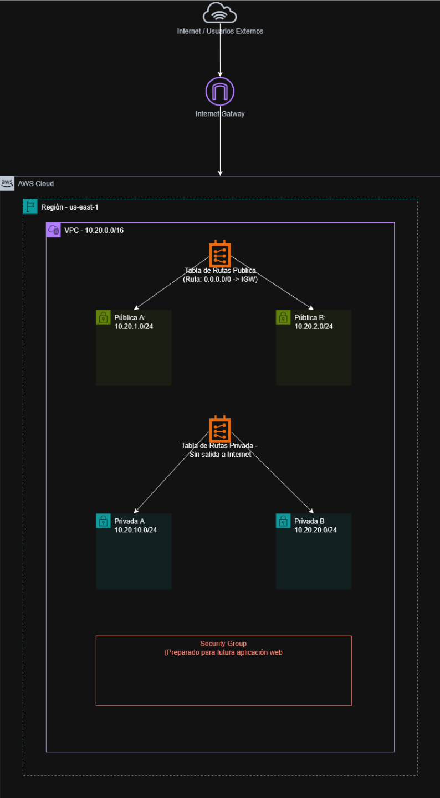

# FastSolutions AWS High-Availability Network (Terraform)

> **Resumen:** Diseño e implementación de una arquitectura de red de alta disponibilidad (HA) en AWS utilizando Terraform. El proyecto despliega una VPC segmentada con subredes públicas y privadas distribuidas en múltiples Zonas de Disponibilidad (AZs), garantizando tolerancia a fallos y aplicando estrictos controles de seguridad.

## Contexto
Este repositorio contiene la solución de infraestructura como código (IaC) para el caso de estudio de **FastSolutions SpA**. La arquitectura está diseñada para alojar aplicaciones web críticas, separando el tráfico público (Frontend/ALB) del privado (Backend/Bases de Datos) y asegurando que la caída de una zona de disponibilidad no afecte la continuidad operacional del negocio.

## Tecnologías Utilizadas
* **Terraform:** Herramienta de Infraestructura como Código (IaC).
* **AWS (Amazon Web Services):** Proveedor de nube (Región us-east-1).
* **Git:** Control de versiones.

## Arquitectura Desplegada

El código `main.tf` despliega los siguientes componentes:
* **VPC:** `10.20.0.0/16` (Aislamiento de red principal).
* **Subredes Públicas (2):** `10.20.1.0/24` (us-east-1a) y `10.20.2.0/24` (us-east-1b).
* **Subredes Privadas (2):** `10.20.10.0/24` (us-east-1a) y `10.20.20.0/24` (us-east-1b).
* **Internet Gateway:** Asociado a la VPC para el tráfico de las subredes públicas.
* **Tablas de Enrutamiento:** 
  * Pública: Ruta `0.0.0.0/0` hacia el Internet Gateway.
  * Privada: Aislada de Internet directo.
* **Asociaciones de Rutas:** 4 asociaciones (una por cada subred).
* **Security Group:** Restringe el tráfico entrante a los puertos TCP 80 (HTTP) y 443 (HTTPS).

## Ciclo de Vida del Despliegue
El proyecto documenta el flujo completo de IaC:
1. `terraform init`: Inicialización.
2. `terraform plan`: Previsualización de los recursos en las 2 AZs.
3. `terraform apply`: Despliegue de la infraestructura.
4. `terraform destroy`: Destrucción limpia de los recursos.

## Estructura del Repositorio
* `main.tf`: Código de la infraestructura (VPC, Subredes, IGW, Route Tables, SG).
* `docs/`: Evidencias visuales (capturas de terminal, consola AWS y diagrama de red).
* `.gitignore`: Protección de archivos de estado y secretos de Terraform.